# Ícones do Windows XP

Recortados de `../WinIcons_48.png` (grade de 20×20 células de 48px).
Variações do mesmo ícone recebem sufixo `-2`, `-3`... na ordem em que aparecem na folha;
em geral uma delas é a versão antiga de 256 cores (pontilhada) e as outras a versão XP.

| Ícone | Descrição | Arquivos (linha-coluna na folha) |
|---|---|---|
|  | Opções de acessibilidade | `accessibility.png` (0-1), `accessibility-2.png` (0-2), `accessibility-3.png` (19-18) |
|  | Adicionar ou remover programas (caixa com CD) | `add-remove-programs.png` (0-9), `add-remove-programs-2.png` (0-10) |
|  | Janela com engrenagem (ferramentas administrativas) | `admin-window.png` (1-13), `admin-window-2.png` (1-16) |
|  | Backup (unidade com fitas) | `backup.png` (13-14), `backup-2.png` (13-15) |
|  | Filmadora | `camcorder.png` (5-4) |
|  | Câmera digital | `camera.png` (4-5), `camera-2.png` (4-6), `camera-3.png` (18-5), `camera-4.png` (18-7) |
|  | Câmera digital compacta | `camera-compact.png` (5-2), `camera-compact-2.png` (5-3) |
|  | CD em branco | `cd.png` (3-10), `cd-2.png` (3-11) |
|  | CD de áudio | `cd-audio.png` (10-2), `cd-audio-2.png` (10-3) |
|  | Unidade de CD | `cd-drive.png` (17-18), `cd-drive-2.png` (18-6), `cd-drive-3.png` (18-15) |
| 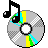 | CD com nota musical | `cd-music.png` (2-5) |
|  | CD com nota e sinal de + | `cd-music-add.png` (2-6), `cd-music-add-2.png` (2-7) |
|  | CD-R | `cd-r.png` (2-13), `cd-r-2.png` (2-14) |
|  | CD-ROM | `cd-rom.png` (2-11), `cd-rom-2.png` (2-12) |
|  | CD-RW | `cd-rw.png` (2-15), `cd-rw-2.png` (2-16) |
|  | CD com interrogação (mídia desconhecida) | `cd-unknown.png` (2-8), `cd-unknown-2.png` (2-9) |
| 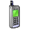 | Celular | `cellphone.png` (4-7), `cellphone-2.png` (4-8) |
|  | Certificado | `certificate.png` (12-17) |
|  | Cartão CompactFlash | `compactflash.png` (3-12), `compactflash-2.png` (3-13) |
| 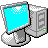 | Computador antigo (monitor ciano e torre) | `computer-classic.png` (2-10) |
|  | Data e hora (calendário com globo) | `date-time.png` (1-0), `date-time-2.png` (1-1) |
|  | Desfragmentador de disco (blocos coloridos) | `defrag.png` (13-16), `defrag-2.png` (13-18) |
|  | X vermelho (excluir) | `delete-x.png` (17-16), `delete-x-2.png` (17-17) |
|  | Vídeo / propriedades de exibição (monitor com paleta) | `display.png` (0-6), `display-2.png` (0-7) |
|  | Monitor com pincel (aparência da área de trabalho) | `display-brush.png` (18-9), `display-brush-2.png` (18-10) |
|  | Documento com relógio (tarefas agendadas) | `document-clock.png` (6-9), `document-clock-2.png` (6-10), `document-clock-3.png` (8-3), `document-clock-4.png` (8-4) |
|  | Unidade com seta verde | `drive-arrow.png` (9-0), `drive-arrow-2.png` (9-2) |
| 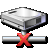 | Unidade desconectada (X vermelho) | `drive-disconnected.png` (17-8) |
| 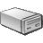 | Disco rígido | `drive-flat.png` (3-8), `drive-flat-2.png` (3-9), `drive-flat-3.png` (13-1), `drive-flat-4.png` (13-10), `drive-flat-5.png` (14-8), `drive-flat-6.png` (14-18), `drive-flat-7.png` (16-16), `drive-flat-8.png` (16-17) |
|  | Unidade de disco plana | `drive-server.png` (13-17) |
|  | Unidade fina (removível) | `drive-slim.png` (3-17), `drive-slim-2.png` (3-18) |
|  | Unidade com interrogação vermelha | `drive-unknown.png` (11-1), `drive-unknown-2.png` (11-2) |
|  | DVD | `dvd.png` (16-1), `dvd-2.png` (16-2) |
|  | Unidade de DVD | `dvd-drive.png` (2-3), `dvd-drive-2.png` (2-4) |
|  | DVD-R | `dvd-r.png` (2-19), `dvd-r-2.png` (3-0) |
|  | DVD-RAM | `dvd-ram.png` (2-17), `dvd-ram-2.png` (2-18) |
|  | DVD-ROM | `dvd-rom.png` (3-15), `dvd-rom-2.png` (3-16) |
|  | DVD-RW | `dvd-rw.png` (3-2), `dvd-rw-2.png` (3-3) |
|  | Ejetar | `eject.png` (7-1), `eject-2.png` (7-2), `eject-3.png` (7-3) |
| 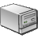 | Disco externo (caixa cinza) | `external-drive.png` (3-6), `external-drive-2.png` (3-7) |
|  | Fax | `fax.png` (15-11), `fax-2.png` (15-12) |
|  | Fax padrão (com check) | `fax-default.png` (15-14), `fax-default-2.png` (15-15) |
|  | Unidade de disquete 3½ | `floppy-drive.png` (12-4), `floppy-drive-2.png` (12-13) |
|  | Unidade de disquete desconhecida | `floppy-drive-unknown.png` (11-3), `floppy-drive-unknown-2.png` (11-10) |
|  | Pasta | `folder.png` (8-9), `folder-2.png` (9-1) |
|  | Pasta com check vermelho | `folder-check.png` (7-11), `folder-check-2.png` (7-12) |
| 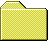 | Pasta fechada | `folder-closed.png` (8-0), `folder-closed-2.png` (9-19) |
|  | Pasta aberta com documento | `folder-documents.png` (16-18) |
|  | Pasta com aba verde | `folder-green-tab.png` (10-0), `folder-green-tab-2.png` (10-1) |
|  | Pastas com seta verde (mover / sincronizar) | `folder-move.png` (12-7), `folder-move-2.png` (12-8), `folder-move-3.png` (18-19), `folder-move-4.png` (19-0) |
|  | Minhas músicas | `folder-music.png` (17-6), `folder-music-2.png` (17-7), `folder-music-3.png` (17-9) |
| 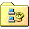 | Pasta com diagrama de rede | `folder-network.png` (12-11), `folder-network-2.png` (12-12) |
| 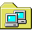 | Pasta com computadores (rede) | `folder-network-computers.png` (14-13), `folder-network-computers-2.png` (19-1) |
|  | Nova pasta (pasta com estrela) | `folder-new.png` (5-8), `folder-new-2.png` (5-9) |
|  | Pasta aberta | `folder-open.png` (10-5), `folder-open-2.png` (10-14) |
|  | Pasta com papéis | `folder-papers.png` (6-8), `folder-papers-2.png` (8-2) |
|  | Pasta aberta com papéis | `folder-papers-open.png` (17-0), `folder-papers-open-2.png` (17-1) |
|  | Pasta com lápis | `folder-pencil.png` (12-9), `folder-pencil-2.png` (12-10) |
|  | Minhas imagens | `folder-pictures.png` (17-3), `folder-pictures-2.png` (17-4), `folder-pictures-3.png` (17-5) |
| 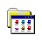 | Pasta com janela de programas | `folder-programs.png` (6-5), `folder-programs-2.png` (6-6), `folder-programs-3.png` (6-7), `folder-programs-4.png` (7-18), `folder-programs-5.png` (7-19), `folder-programs-6.png` (8-1), `folder-programs-7.png` (9-15), `folder-programs-8.png` (9-16), `folder-programs-9.png` (9-17) |
| 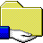 | Pasta compartilhada (mão) | `folder-share-hand.png` (19-15), `folder-share-hand-2.png` (19-16), `folder-share-hand-3.png` (19-17) |
|  | Pasta compartilhada na rede | `folder-shared-network.png` (15-2), `folder-shared-network-2.png` (15-3) |
| 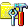 | Pasta com ferramentas (painel de controle) | `folder-tools.png` (7-10) |
|  | Meus vídeos | `folder-videos.png` (17-10), `folder-videos-2.png` (17-11), `folder-videos-3.png` (17-12) |
|  | Fonte bitmap (A vermelho) | `font-raster.png` (13-4), `font-raster-2.png` (13-5) |
|  | Fonte (a itálico) | `font-script.png` (13-8), `font-script-2.png` (13-9) |
|  | Fonte TrueType (TT) | `font-truetype.png` (13-6), `font-truetype-2.png` (13-7) |
| 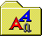 | Pasta de fontes | `fonts-folder.png` (9-18) |
|  | Proibido / sem acesso | `forbidden.png` (7-4), `forbidden-2.png` (7-5), `forbidden-3.png` (7-8), `forbidden-4.png` (7-9) |
|  | Engrenagem (configurações / serviços) | `gear.png` (0-16), `gear-2.png` (0-17) |
|  | Globo com cabo (conexão com a Internet) | `globe-cable.png` (14-14), `globe-cable-2.png` (14-15), `globe-cable-3.png` (19-2), `globe-cable-4.png` (19-3) |
|  | Globo com mouse | `globe-mouse.png` (1-10), `globe-mouse-2.png` (1-15) |
|  | Globo com foto | `globe-photo.png` (18-11), `globe-photo-2.png` (18-12) |
|  | Globo de mesa (antigo ícone de rede/web) | `globe-stand.png` (0-0) |
|  | Globo com seta para cima (publicar na web) | `globe-upload.png` (18-1), `globe-upload-2.png` (18-2) |
|  | Ajuda (círculo com ?) | `help-circle.png` (5-18), `help-circle-2.png` (6-0), `help-circle-3.png` (6-1), `help-circle-4.png` (8-12), `help-circle-5.png` (8-13), `help-circle-6.png` (8-14), `help-circle-7.png` (19-8), `help-circle-8.png` (19-10), `help-circle-9.png` (19-11) |
|  | Documento de ajuda (.chm) | `help-document.png` (1-5), `help-document-2.png` (5-10) |
| 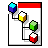 | Documento com hierarquia | `hierarchy-document.png` (14-9) |
|  | Rede doméstica (casa) | `home-network.png` (19-6), `home-network-2.png` (19-7) |
|  | Informação (balão com i) | `info-bubble.png` (19-12), `info-bubble-2.png` (19-13) |
|  | Internet Explorer | `internet-explorer.png` (7-14), `internet-explorer-2.png` (7-15), `internet-explorer-3.png` (7-16) |
|  | Globo com órbita (Internet / opções da Internet) | `internet-globe.png` (0-11), `internet-globe-2.png` (1-2) |
|  | Chave em botão quadrado | `key-tile.png` (6-2), `key-tile-2.png` (6-3), `key-tile-3.png` (6-4), `key-tile-4.png` (10-8), `key-tile-5.png` (10-9), `key-tile-6.png` (10-10) |
|  | Teclado (monitor com teclado) | `keyboard.png` (1-11), `keyboard-2.png` (1-12) |
|  | Cadeado | `lock.png` (10-18), `lock-2.png` (10-19), `lock-3.png` (11-0) |
|  | Lupa (pesquisar) | `magnifier.png` (5-16), `magnifier-2.png` (5-17), `magnifier-3.png` (8-8), `magnifier-4.png` (8-10), `magnifier-5.png` (8-11) |
|  | Arquivo de mídia | `media-file.png` (16-10), `media-file-2.png` (16-11) |
|  | Cartão PCMCIA / memória | `memory-card.png` (3-19), `memory-card-2.png` (4-0) |
| 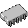 | Chip de memória | `memory-chip.png` (19-9), `memory-chip-2.png` (19-14) |
| 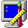 | Monitor com régua e lápis | `monitor-paint.png` (18-8) |
|  | Mouse | `mouse.png` (16-12), `mouse-2.png` (16-13) |
| 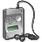 | Tocador de MP3 com fone | `mp3-player.png` (3-4), `mp3-player-2.png` (3-5) |
|  | Borboleta do MSN | `msn-butterfly.png` (17-13), `msn-butterfly-2.png` (17-14), `msn-butterfly-3.png` (17-15) |
|  | Arquivo de música | `music-file.png` (16-5), `music-file-2.png` (16-6) |
|  | Meu computador | `my-computer.png` (3-1), `my-computer-2.png` (3-14) |
|  | Meus locais de rede | `my-network-places.png` (15-9), `my-network-places-2.png` (15-10) |
|  | Rede (três computadores) | `network.png` (7-13), `network-2.png` (7-17) |
|  | Computador com globo (rede) | `network-computer-globe.png` (5-11) |
|  | Unidade de rede | `network-drive.png` (15-4), `network-drive-2.png` (15-13), `network-drive-3.png` (16-0) |
|  | Unidade de rede desconectada | `network-drive-disconnected.png` (16-9), `network-drive-disconnected-2.png` (16-19) |
|  | Fax de rede | `network-fax.png` (15-16), `network-fax-2.png` (15-17) |
|  | Fax de rede padrão | `network-fax-default.png` (15-18), `network-fax-default-2.png` (15-19) |
|  | Nova pasta de rede | `network-folder-new.png` (19-4), `network-folder-new-2.png` (19-5) |
|  | Conexões de rede (monitor com globo) | `network-globe.png` (0-14), `network-globe-2.png` (0-15) |
|  | Monitor com globo (Internet) | `network-globe-monitor.png` (5-19), `network-globe-monitor-2.png` (6-13) |
|  | Impressora de rede | `network-printer.png` (4-9), `network-printer-2.png` (4-10), `network-printer-3.png` (12-0), `network-printer-4.png` (12-1), `network-printer-5.png` (12-2) |
|  | Bloco de notas | `notepad.png` (12-18), `notepad-2.png` (12-19) |
| 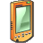 | PDA / Pocket PC | `pda.png` (4-16), `pda-2.png` (4-17) |
| 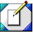 | Quadro com lápis (editar) | `pencil-tile.png` (12-14), `pencil-tile-2.png` (12-15), `pencil-tile-3.png` (12-16) |
| 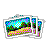 | Fotos | `photos.png` (16-7), `photos-2.png` (16-8) |
|  | Gráfico de pizza (desempenho / uso de disco) | `pie-chart.png` (0-18), `pie-chart-2.png` (0-19) |
|  | Botão de energia azul (fazer logoff / espera) | `power-button.png` (11-6), `power-button-2.png` (11-7) |
| 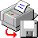 | Imprimir em arquivo (impressora com disquete) | `print-to-file.png` (12-3) |
|  | Impressora | `printer.png` (4-14), `printer-2.png` (5-5), `printer-3.png` (18-3), `printer-4.png` (18-4) |
|  | Impressora padrão (com check) | `printer-default.png` (13-19), `printer-default-2.png` (14-0), `printer-default-3.png` (14-1), `printer-default-4.png` (14-2), `printer-default-5.png` (14-3), `printer-default-6.png` (14-4), `printer-default-7.png` (14-5), `printer-default-8.png` (14-6) |
| 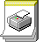 | Documento de impressão | `printer-document.png` (11-17) |
|  | Impressora com disquete | `printer-floppy.png` (12-5), `printer-floppy-2.png` (12-6) |
| 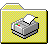 | Pasta com impressora | `printer-folder.png` (11-14), `printer-folder-2.png` (11-15), `printer-folder-3.png` (11-16) |
|  | Impressora de fotos | `printer-photo.png` (18-13), `printer-photo-2.png` (18-14) |
| 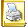 | Impressoras e aparelhos de fax | `printers-faxes.png` (11-18), `printers-faxes-2.png` (11-19) |
|  | Impressoras e outros itens de hardware | `printers-hardware.png` (0-12), `printers-hardware-2.png` (0-13) |
| 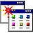 | Janelas com estrela (acesso e padrões de programas) | `program-access.png` (0-8) |
| 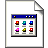 | Arquivo de programa / aplicativo | `program-document.png` (1-14), `program-document-2.png` (17-2) |
|  | Lixeira clássica vazia | `recycle-bin-classic.png` (15-5), `recycle-bin-classic-2.png` (15-6) |
|  | Lixeira clássica cheia | `recycle-bin-classic-full.png` (15-7), `recycle-bin-classic-full-2.png` (15-8) |
|  | Lixeira vazia | `recycle-bin-empty.png` (9-9), `recycle-bin-empty-2.png` (9-10), `recycle-bin-empty-3.png` (9-11), `recycle-bin-empty-4.png` (18-16), `recycle-bin-empty-5.png` (18-17), `recycle-bin-empty-6.png` (18-18) |
|  | Lixeira cheia | `recycle-bin-full.png` (9-12), `recycle-bin-full-2.png` (9-13), `recycle-bin-full-3.png` (9-14) |
| 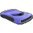 | Unidade removível azul (Zip) | `removable-drive-blue.png` (4-13), `removable-drive-blue-2.png` (4-15), `removable-drive-blue-3.png` (16-14), `removable-drive-blue-4.png` (16-15) |
| 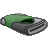 | Unidade removível verde | `removable-drive-green.png` (4-11), `removable-drive-green-2.png` (4-12) |
| 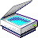 | Scanner | `scanner.png` (4-18), `scanner-2.png` (4-19), `scanner-3.png` (5-0) |
| 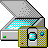 | Scanners e câmeras | `scanner-camera.png` (5-1) |
|  | Cartão SD | `sd-card.png` (4-1), `sd-card-2.png` (4-2) |
|  | Documento com lupa (pesquisar arquivos) | `search-document.png` (5-15), `search-document-2.png` (11-8), `search-document-3.png` (11-9) |
|  | Papel com lupa (pesquisar) | `search-files.png` (7-6), `search-files-2.png` (7-7) |
|  | Pasta com lupa (pesquisar) | `search-folder.png` (10-11), `search-folder-2.png` (10-12), `search-folder-3.png` (10-13) |
|  | Janela com lupa (pesquisar) | `search-window.png` (1-6), `search-window-2.png` (1-7) |
|  | Arquivo de instalação (.inf) | `setup-file.png` (13-2), `setup-file-2.png` (13-3) |
| 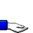 | Mão de compartilhamento | `share-hand.png` (9-6), `share-hand-2.png` (9-7), `share-hand-3.png` (9-8) |
|  | Cartão SmartMedia | `smartmedia.png` (4-3), `smartmedia-2.png` (4-4) |
|  | Sons e dispositivos de áudio | `sounds.png` (1-3), `sounds-2.png` (1-4) |
|  | Fala (monitor com balão) | `speech.png` (1-8), `speech-2.png` (1-9) |
|  | Monitor com lua (proteção de tela / espera) | `standby-monitor.png` (8-18), `standby-monitor-2.png` (8-19) |
|  | Estrela (favoritos) | `star.png` (5-12), `star-2.png` (5-13), `star-3.png` (5-14), `star-4.png` (10-4), `star-5.png` (10-6), `star-6.png` (10-7), `star-7.png` (14-10), `star-8.png` (14-11), `star-9.png` (14-12) |
| 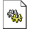 | Arquivo de sistema (engrenagens) | `system-file.png` (13-0) |
|  | Prancheta com check e lápis (tarefas) | `task-check.png` (2-0), `task-check-2.png` (2-1), `task-check-3.png` (2-2), `task-check-4.png` (6-18), `task-check-5.png` (6-19), `task-check-6.png` (7-0), `task-check-7.png` (8-5), `task-check-8.png` (8-6), `task-check-9.png` (8-7), `task-check-10.png` (11-11), `task-check-11.png` (11-12), `task-check-12.png` (11-13) |
|  | Campo de texto com cursor (renomear) | `text-field.png` (17-19), `text-field-2.png` (18-0) |
|  | Desligar (botão pequeno) | `turn-off.png` (6-15), `turn-off-2.png` (6-16), `turn-off-3.png` (6-17) |
|  | Desligar o computador (botão grande) | `turn-off-tile.png` (9-3), `turn-off-tile-2.png` (9-4), `turn-off-tile-3.png` (9-5) |
| 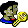 | Contas de usuário com chave (senhas) | `user-key.png` (0-3), `user-key-2.png` (1-17), `user-key-3.png` (11-4), `user-key-4.png` (11-5) |
|  | Contas de usuário | `users.png` (0-4), `users-2.png` (0-5), `users-3.png` (1-18), `users-4.png` (1-19) |
|  | Câmera de vídeo / webcam | `video-camera.png` (5-6), `video-camera-2.png` (5-7) |
|  | Arquivo de vídeo | `video-file.png` (16-3), `video-file-2.png` (16-4) |
|  | Página com globo e pastas (pastas da web) | `web-folders.png` (14-16), `web-folders-2.png` (14-17) |
|  | Moldura dourada com globo | `web-frame.png` (15-0), `web-frame-2.png` (15-1) |
|  | Página da web | `web-page.png` (14-19) |
| 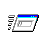 | Janela pequena (executar / minimizada) | `window-small.png` (6-11), `window-small-2.png` (6-12), `window-small-3.png` (6-14), `window-small-4.png` (8-15), `window-small-5.png` (8-16), `window-small-6.png` (8-17), `window-small-7.png` (13-11), `window-small-8.png` (13-12), `window-small-9.png` (13-13) |
|  | Logo do Windows sobre globo (Windows Update) | `windows-globe.png` (10-15), `windows-globe-2.png` (10-16), `windows-globe-3.png` (10-17) |
